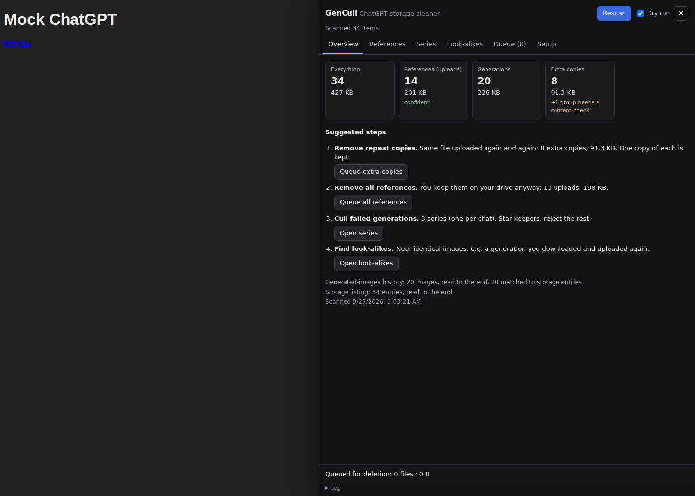
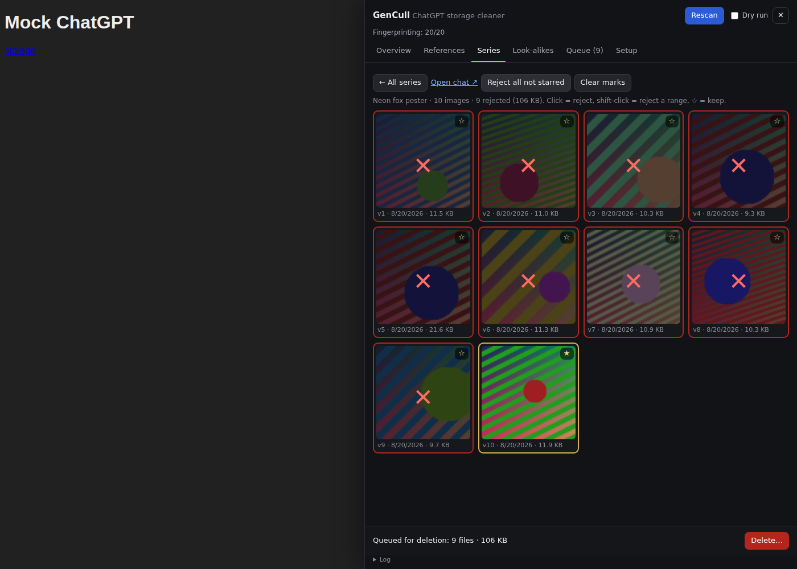

# GenCull: version manager and deduplicator for generative AI

**GenCull frees up your ChatGPT storage.** It finds the reference images you uploaded again and again, removes them in bulk, and lets you cull failed generations one chat at a time.

*Cull* is the photographer's word for throwing out the bad shots so the good ones are easy to find.

> **Status: v0.1, not yet tried on a real account.** ChatGPT has no public API for storage, so GenCull uses the same internal requests the ChatGPT website uses. It has been tested end to end against a fake ChatGPT server built from what other open-source tools report (see [Testing](#testing)). Follow the [first-run checklist](#first-run-checklist): dry run first, then delete one test file.



## The problem

On ChatGPT Plus, storage is capped at 20 GB. A generative artist who does 100+ revisions per piece fills it quickly, for three reasons:

1. **Every attachment is a new file.** Attach the same moodboard to 40 chats and ChatGPT stores 40 copies.
2. **Generations pile up.** Every re-roll is kept, including the obvious fails.
3. **Round trips.** Download a generation, upload it again as a reference, and you store it twice.

The storage page lets you delete one file at a time. With 10,000 images, that is not a real option.

## What GenCull does

1. **Scan.** It reads your whole storage listing (what Settings → Storage shows). It also reads your generated-images history (what the Library's Images tab shows).
2. **Sort.** Any file found in your generated-images history is a *generation*. Everything else is an *upload*, i.e. your reference. GenCull tells you how sure it is (see [How it decides](#how-it-decides)).
3. **Suggest.** For each suggestion it shows the number of files and the space it frees:
   - **Extra copies:** the same file stored more than once. One copy of each is kept.
   - **All references:** every uploaded image. Documents such as PDFs are never included.
   - **Series:** your generations grouped by chat, oldest first, as a version history. Star the keepers, click the fails, or press "reject all not starred".
   - **Look-alikes:** near-identical images, e.g. two re-rolls that barely differ, or a generation and its re-upload.
4. **Delete, carefully.** Nothing is deleted without your confirmation:
   - Dry run is on by default.
   - Before a real run, a list of every file is downloaded.
   - Exactly one test file is deleted first, and GenCull waits for you to check the storage counter.
   - It stops after three failures in a row.



## Install

GenCull is a *userscript*: a small program that runs inside the chatgpt.com tab, with your existing login. It talks only to chatgpt.com.

### Option A: userscript manager (recommended, survives reloads)

1. Install [Tampermonkey](https://www.tampermonkey.net/) or [Violentmonkey](https://violentmonkey.github.io/) in Chrome, Edge, Firefox or Brave.
   - In Chrome, if Tampermonkey says userscripts are blocked, open the extension's *Details* page and turn on **Allow User Scripts**.
2. Open the raw script and let the manager install it:
   `https://raw.githubusercontent.com/marsrobertson/version-manager-deduplicator-for-generative-AI/claude/relaxed-meitner-x0f4bo/dist/gencull.user.js`
   (This URL changes to `main` once the branch is merged.)
3. Reload chatgpt.com. A **GenCull** tab appears on the right edge of the window.

### Option B: paste into the console (nothing to install)

1. Open chatgpt.com. Open DevTools (F12) and go to the **Console** tab.
2. Paste the contents of [`dist/gencull.user.js`](dist/gencull.user.js) and press Enter. If Chrome asks, type `allow pasting` first.
3. The GenCull tab appears. It is gone after a page reload; paste again if needed.

## First-run checklist

1. **Teach it (1 minute, recommended).** With GenCull running:
   - Open **Settings → Storage → Images** and scroll the list a little.
   - Delete **one** image you don't need, using ChatGPT's own delete button.

   GenCull watches those two requests and learns exactly how *your* account lists and deletes files. The Setup tab shows what it learned.
2. **Scan.** Open GenCull and press **Scan my storage**. Read the numbers and the notes under them.
3. **Rehearse.** Press **Queue extra copies**, then **Simulate delete…** in the footer. With dry run on, nothing is sent; you only see what would be sent.
4. **Delete for real.** Untick **Dry run**, press **Delete…**, and type `delete`. GenCull downloads the list of files, then deletes one test file.
5. **Check.** Open Settings → Storage in another tab: the image count should have dropped by one. If it did, press **Continue**.
6. **Rescan** when done. OpenAI says deleted files are permanently removed within 30 days. Whether your quota counter drops at once or later is one of the [things I could not check](#what-is-not-verified).

Then do the same with **references**, then work through **Series** at your own pace. Your stars and rejects are saved in the browser, so you can stop and come back later.

## How it decides

### Upload or generation?

| Evidence | Result | Confidence |
|---|---|---|
| The file id appears in your generated-images history | generation | high |
| The listing marks it as generated (e.g. a `source` field) | generation | medium |
| Not in the history, **and** the history was read to the end, **and** at least 80% of the history matched storage entries | upload | high |
| Not in the history, but the history was incomplete or poorly matched | upload? | low |
| No history available | unknown | low |

**Queue all references** only takes *high*-confidence uploads. If the split is uncertain, the button stays locked. You can unlock it in the References tab, but only after looking at the thumbnails. This protects against the worst failure: a generation mislabelled as a reference and deleted in bulk.

### Exact copies

Copies are files with the **same name and the same byte size**. Uploading the same file from your drive gives exactly that, so this works without downloading anything. There are two exceptions:

- **Generic names** (`image.png`, `untitled.jpg`, `ChatGPT Image.png`). Two different images can share both the name and the size by coincidence.
- **Two generations with the same name and size.** Each generation is unique, so matching sizes are more likely a coincidence than a copy.

In these cases GenCull shows the group but won't touch it until **Check contents** downloads the files and compares their SHA-256 hashes (byte-level fingerprints).

When it removes copies it keeps one:

- the **generation**, if the group contains one;
- otherwise the **oldest** copy. The original generation is always older than its re-uploads, so the chat it came from keeps its image.

### Look-alikes

For each image GenCull computes a **dHash**: a 64-bit sketch of the image made by shrinking it to 9×8 grey pixels and recording which neighbour is brighter. Re-encoding and resizing barely change it, while real edits change many bits. Two images whose sketches differ by at most *N* bits (the Strictness slider, default 5) are look-alikes.

The sketches are cached in your browser. Fingerprinting may need to download each image once, which can be a lot of data for thousands of images. GenCull shows an estimate before it starts.

## Safety and privacy

- **Local only.** GenCull sends requests only to chatgpt.com (and the image links ChatGPT itself hands out). No analytics, no third-party servers.
- **Your login token stays in memory.** It is never written to disk. The request *shapes* it learns (paths and parameter names, with ids replaced by placeholders) are kept in `localStorage`. Stars, rejects and fingerprints are kept in IndexedDB. The Setup tab has **Forget learned requests**.
- **Only storage requests are learned.** Chat, GPT and project traffic is ignored, even if a message contains the word "delete" (there is a test for this).
- **Nothing is deleted without confirmation.** Dry run by default, a test file first, a downloaded record, and a stop after three failures in a row.
- **Diagnostics without data.** **Copy diagnostics** in Setup produces the *structure* of ChatGPT's responses with names, ids and URLs stripped. Share it if something breaks and you want the parser fixed.

### Risks you should know

- **Unofficial.** These are internal endpoints. OpenAI can change them at any time, and GenCull will then fail (loudly, not silently).
- **Terms of Use.** OpenAI's [Terms of Use](https://openai.com/policies/row-terms-of-use/) forbid "automatically or programmatically extract[ing] data or Output". GenCull reads your own file list in order to delete your own files, at a gentle pace. That is a narrow use, but it is still automated access, so the decision is yours. I am not aware of accounts being penalised for storage cleanup tools; I also have no evidence either way.
- **Deleted means deleted.** Once a file is gone, the chat that used it shows a missing image. For references you keep on your drive, that is the point. For generations, download first if unsure.

## What is not verified

I could not log in to a real ChatGPT account while building this. These points are open:

1. **The exact endpoints on your account.** Built in as fallbacks:
   - Listing: `POST /backend-api/files/library`, reported by [sand7000/chat-gpt-bulk-delete](https://github.com/sand7000/chat-gpt-bulk-delete).
   - Deleting: `POST /backend-api/files/library/files/delete-batch`, used by [GPT-Library-Cleaner](https://github.com/index7777/GPT-Library-Cleaner) v2.7.0 (Sept 2026).
   - Deleting: `…/files/{id}/delete_stream`, reported in [ChatGPT-bulk-delete-chats#7](https://github.com/johnvouros/ChatGPT-bulk-delete-chats/issues/7).
   - Generated-images history: `GET /backend-api/my/recent/image_gen`, used by [chatgpt-library-archiver](https://github.com/jakerains/chatgpt-library-archiver).

   Teaching GenCull (step 1 of the checklist) makes it use your account's real requests instead.
2. **Older generated images.** Press reports say images generated before the May 2026 Library launch can't be deleted individually, only by deleting the whole chat. If that is true, deleting them will fail with an error, and GenCull reports that. It does not delete chats.
3. **Quota timing.** OpenAI says deleted files are "scheduled for permanent removal within 30 days". Whether the 20 GB counter drops at once or later is unknown.
4. **Sizes of history-only generations.** If a generation appears in the history but not in the storage listing, its size is unknown and it may not be deletable from storage at all.

## Testing

```bash
npm install           # installs playwright-core (for the browser tests only)
npm test              # 19 unit tests: parsing, classification, duplicates, dHash, request learning
npm run test:e2e      # builds, then runs 3 browser tests in Chromium against a fake ChatGPT
npm run mock -- learn # run the fake ChatGPT at http://127.0.0.1:8787 (modes: known, learn, nogen)
```

The browser tests cover:
- **known:** the reported endpoints.
- **learn:** the reported endpoints are gone, and GenCull must learn unusual ones (`page_token` paging, `DELETE /library/v2/items/:id`) by watching the fake storage page.
- **nogen:** no generated-images history, so bulk reference removal must stay locked and copy removal must keep the original generation.

## Code layout

| File | What it does |
|---|---|
| `src/core.js` | Pure logic: response parsing, classification, copy groups, series, dHash, request templates, paging |
| `src/net.js` | Request-learning hook, login, paging, image download, delete execution |
| `src/store.js` | IndexedDB / localStorage wrappers |
| `src/ui.js` | The panel (plain DOM in a shadow root; no `innerHTML`) |
| `scripts/build.mjs` | Concatenates `src/` into `dist/gencull.user.js` |
| `test/` | Unit tests, fake ChatGPT server, browser tests |

`dist/gencull.user.js` is committed so it can be installed from a URL. Rebuild it with `npm run build` after editing `src/`.
